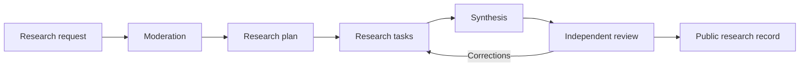

# LLM.Giving

**Turn donated AI time into public, evidence-linked research.**

LLM.Giving coordinates research requests, volunteer contributions, synthesis, and independent review. People bring their own AI tools. The platform preserves the research record, checks structured submissions, and routes work through a transparent workflow.

Built by [Austin Oehlerking](https://github.com/austinoehlerking). Contact: [austin@oehlerk.ing](mailto:austin@oehlerk.ing).

[Website](https://llm.giving) · [Architecture](docs/architecture.md) · [Development](docs/development.md) · [Contributing](CONTRIBUTING.md) · [Security](SECURITY.md)

## How it works

1. **Ask a useful question.** Submit a research brief, optionally describing a tool to build or calculations to reproduce.
2. **Approve the public brief.** An administrator reviews the request and attachments before publication.
3. **Contribute with your own AI.** Copy a task and its complete context, work in your chosen AI tool, and return a structured result.
4. **Build and review the evidence.** Accepted plans unlock research, synthesis, and independent review. Corrections reopen affected work and its dependencies.
5. **Keep the record useful.** Follow the public activity ledger, inspect sources and limitations, cite results, and download eligible research artifacts.



## What makes the project different

- **Bring your own AI.** No runtime AI calls, paid model APIs, or server-side model inference.
- **Evidence stays attached.** Results retain source records, claim-to-passage links, assumptions, uncertainty, and review history.
- **Corrections have consequences.** Invalidated work reopens the affected tasks and dependent synthesis or review.
- **Exact handoffs are preserved.** Immutable issued prompt archives and hashes make the platform's instructions inspectable.
- **Privacy is a publication boundary.** Parent visibility and child moderation govern public pages, context exports, and downloads.
- **Research can include working materials.** Typed visual artifacts, inert source files, test records, and reproducible calculation packages remain linked to their research.
- **A small production stack.** PHP, PDO, and MariaDB/MySQL; semantic server-rendered HTML and local assets. Node is development tooling only.

The platform validates structure, references, permissions, and workflow state. It does not certify scientific truth, authenticate a contributor's AI provider, or execute submitted code. Independent review and visible limitations remain essential.

## Engineering overview

| Layer | Approach |
| --- | --- |
| Application | PHP 8.2+, server-rendered HTML, progressively enhanced local JavaScript |
| Persistence | PDO, MariaDB/MySQL, versioned SQL migrations |
| Workflow | Revision-aware tasks, immutable context snapshots, transactional correction propagation |
| Access | Administrator sessions, request-scoped private management links, central public visibility checks |
| Files | Private storage, validated uploads, gated downloads; submitted code is never executed |
| Verification | Source checks, server integration tests, browser workflows, first-viewport and enlarged-text checks |
| Hosting | Public document root separated from application source, configuration, and runtime storage |

See [architecture](docs/architecture.md) for the data model and trust boundaries, [QA evidence](docs/qa-report.md) for executed checks and limitations, and [hosting guidance](docs/siteground.md) for deployment requirements.

## Local setup (Windows, existing PHP/MariaDB)

Prerequisites: PHP 8.2+ with PDO MySQL, fileinfo and GD; MariaDB; Node 22.16+ only for local tooling. The Windows launcher defaults to the current user's Scoop MariaDB installation; set MARIADB_BIN for another location. See the portable setup below for other platforms.

```powershell
cd D:\Codex\LLM-Giving
node tools/dev.mjs setup
node tools/dev.mjs start
```

The app listens on http://127.0.0.1:8086. MariaDB uses loopback port 3318. All local database files, logs, email, uploads, sessions, browser profiles and screenshots are under storage/. The launcher generates random local database credentials in ignored .env and storage/local-runtime.json. No default administrator or production credentials exist. Keep the start process running while using the app; Ctrl+C stops its PHP web server. In sandboxed tool environments, keep that command in an active terminal session so its child database process survives.

In a second terminal, initialize an administrator with a password supplied on stdin. This command also resets a forgotten admin password:

```powershell
$securePassword = Read-Host 'Administrator password (14+ characters)' -AsSecureString
$plainPassword = [System.Net.NetworkCredential]::new('', $securePassword).Password
$plainPassword | php bin/console.php admin you@example.test
Remove-Variable plainPassword, securePassword
```

Open /admin and sign in. The source does not contain a default password.

Optional, explicitly labeled synthetic examples:

```powershell
php bin/console.php seed
```

## Portable native PHP setup

Create a dedicated MariaDB database and user. Copy .env.example to .env; set APP_URL and DB_HOST, DB_PORT, DB_NAME, DB_USER and DB_PASSWORD. Enable pdo_mysql, fileinfo and gd in PHP. Use utf8mb4 and a 32 MB database packet limit. Run:

```sh
php bin/console.php migrate
php bin/console.php admin admin@example.test < /private/path/password-input
php -d upload_max_filesize=10M -d post_max_size=32M -S 127.0.0.1:8086 -t public public/router.php
```

Do not store the password-input file in the project or public directory. The stdin example is optional; interactive shell piping can avoid a file. Set upload_tmp_dir and session storage to private writable directories. The provided Windows launcher explicitly places them on D:.

## Docker Compose option

Docker is not installed on the development machine used for this build; the native setup is the verified route. The Compose definition is supplied for reproducibility but requires a separate Docker test.

Create .env from .env.example and choose nonempty DB_PASSWORD and DB_ROOT_PASSWORD. Then:

```sh
docker compose up -d --build
docker compose exec app php bin/console.php migrate
docker compose exec -T app php bin/console.php admin you@example.test
```

The last command reads the administrator password from stdin. The app is exposed only on 127.0.0.1:8086. Database and application storage are bind-mounted under storage/docker-*; set their ownership appropriately for the container's www-data user. Node is not required in production.

## Local checks

Keep the native local database running first:

```powershell
node tools/check.mjs
node tools/qa.mjs viewport
node tools/qa.mjs
node tools/qa.mjs library
node tools/qa.mjs blog
node tools/qa.mjs submission
node tools/qa.mjs workflow
node tools/qa.mjs artifacts
node tools/qa.mjs quarantine
node tools/qa.mjs handoffs
node tools/qa.mjs launch
node tools/qa.mjs legal
node tools/qa.mjs citations
node tools/qa.mjs requirements
node tools/qa.mjs setup
node tools/qa.mjs tools
node tools/qa.mjs calculations
```

For the complete set in one command, run `node tools/qa-all.mjs` while the local development server/database is running. It saves timestamped logs and fresh report snapshots under `storage/qa/runs/`. `node tools/source-check.mjs` runs database-independent source hygiene and syntax checks. See [the development guide](docs/development.md) for the module map and tooling contracts.

The browser runner starts its own PHP server on 127.0.0.1:8087, uses installed Microsoft Edge, writes evidence under storage/qa, and stops only its own PHP process. PLAYWRIGHT_MODULE and QA_BROWSER may point to existing installations on another machine. The current machine uses the bundled Playwright library without installing dependencies. If absent elsewhere, the package.json declares the optional development dependency; install it only with permission.

Browser tests create random QA administrator credentials and labeled synthetic requests, and exercise real form interactions. Some suites clean up their fixtures; others retain clearly labeled examples for inspection. Use a dedicated local development database. Failure evidence remains private under storage/qa. The runner and database-backed fixtures refuse production/nonlocal configuration and remote database hosts. It does not deploy, send real emails, or contact SiteGround. A full run includes the local upload and purge lifecycle; do not point the runner at a production database.

See [QA evidence](docs/qa-report.md) for executed results and limitations.

Local quarantine QA: `node tools/qa.mjs quarantine` retains its clearly labeled synthetic topic for inspection and writes screenshots to `storage/qa/quarantine/index.html`. It tests unchanged quarantined plans, rejection without advancement, fresh submission, approval exactly once, retained disclosures, UTC decisions, and first-viewport actions at 1366×768, 390×844 and 375×667, plus 200% text reflow. `node tools/check.mjs` includes outcome, authorization, duplicate-decision, stale-round and evidence-isolation checks in `tests/quarantine.php`. These fixtures test software behavior, not scientific findings or real model provenance. `node tools/qa.mjs handoffs` tests exact archive bytes, clipboard copying, initial prompt edits, removed instructions, added sources, preferred conclusions, uncertainty and unchanged/repair controls. It retains labeled fixtures and writes screenshots to `storage/qa/v1-safeguards/index.html`.


## Editorial blog

The Blog link opens /blog and four reviewed guides at /blog/{slug}. The catalogue in content/blog-drafts/articles.json explicitly selects published articles; drafting material and review notes are not served. After editing an approved article, run `node tools/build-blog.mjs` to rebuild content/blog/articles.json. The compiler uses the project safe writer. Checks reject stale output. Node is needed only for this development step; PHP serves escaped structured article blocks at runtime.

`node tools/qa.mjs blog` verifies all articles, metadata, reading/navigation, initial viewport actions, no-JavaScript rendering and enlarged text. Evidence stays under storage/qa/blog and storage/qa/blog-report.json.

## Workflows

- Submit a research request at /submit; save its private fragment-based management link. Use **Copy AI prompt to assist setup** for a step-by-step interview in your own AI, then paste its final JSON draft and select **Fill request fields**. Review/edit the filled request before submitting. Private contact details and consent remain manual. See [guided setup](docs/request-setup.md).
- At /admin, inspect and approve the request and each attachment separately.
- Find approved research on the homepage or /research with compact cards, text search, category and tag selection, status filtering, and a no-contributions filter. Sort by newest, activity, updates, contribution counts, or title; filters persist through pagination and work without JavaScript.
- Topic approval opens Needs Research Plan. Copy a task prompt with an immutable full context package, use your own AI, and return structured task JSON.
- Valid Max/Ultra planning results create research tasks, synthesis and independent verification automatically. Routine workflow submissions have no admin approval gate.
- Clarification or blocker results pause the workflow. The original submitter or admin can respond and restart planning with the complete history.
- Catch up through the UTC ledger. Use admin workflow exceptions only for removal, intervention or policy changes.
- Legacy supplementary research prompts and contribution routes remain available; complete safe contributions publish automatically.
- Paste structured JSON at the contribution form, load into editable fields, preview and submit.
- Missing metadata stays missing and flags the contribution for enhanced review; explicit admin exception rationale is required to publish it.
- Workflow packets require structured search/access records and claim-to-source evidence across planning, research, synthesis and review. Unsupported claim audits reopen the affected task and dependent work automatically; documented uncertainty remains a useful result. See [the evidence contract](docs/research-evidence.md). A completed cycle can receive another review without admin approval. The canonical findings ledger remains an optional administrator-curated view.
- Visual research artifacts support native charts, diagrams, step-based animations and interactive scenario pages, with linked claims/sources, typed backing data, assumptions, limitations and JSON/CSV/SVG exports. Independent visual audits can reopen affected work. See [visual artifacts](docs/research-artifacts.md).
- Use the private link to propose a revision, pause, solve, withdraw or rotate the key.
- Restore withdrawn research or permanently purge a disposable request through administration.
- Manage feedback, categories, tags, public pages, related questions, supersession and settings.

## Email, files, maintenance

MAIL_DRIVER=file writes private delivery JSON to storage/mail. MAIL_DRIVER=mail uses configured server mail with MAIL_FROM; delivery acceptance is not proof of recipient delivery. The admin interface configures the safe adapter/sender settings, shows delivery status and allows request-related notices. Database and other secrets remain environment-only. Configure the mail transport before offering live recovery.

Allowed attachments: validated TXT/MD, PDF, PNG and JPEG. Images are re-encoded; active-content signatures are rejected; fileinfo validates MIME. Default limits: 10 MB/file, 25 MB across a request, max 10 files/submission. Raw Markdown and HTML are displayed as escaped text, never executable markup. Conservative PDF checks are not a full malware detector. Optional CLAMSCAN_PATH enables a locally installed scanner; absent scanning is explicitly shown in admin.

Run `php bin/console.php archive` via a hosting cron to apply inactivity archiving, or use System maintenance. No automated AI workers are involved. File purge failures remain in a durable retry queue. The administrator can retry them from System maintenance.

`php bin/console.php backup` writes a private SQL export to storage/backups. Back up uploads, configuration and the persistent `storage/private/handoff.key` separately, protect all backups and test restoration before launch. System administration can also create the private SQL backup through a confirmation form; it never serves the backup or exposes secrets through the web interface.

## Documentation

- [Code review and cleanup record](docs/code-review-2026-10-20.md)
- [Development guide and repository map](docs/development.md)
- [Architecture and data relationships](docs/architecture.md)
- [Submission schema and prompts](docs/submissions.md)
- [SiteGround compatibility and launch gates](docs/siteground.md)
- [Security policy](SECURITY.md)
- [Contribution guidelines](CONTRIBUTING.md)
- [Implementation and QA report](docs/qa-report.md)
- [Approved research library design and verification](docs/library-implementation.md)

Source: AGPL-3.0 (LICENSE). Eligible original research and reviews: CC BY 4.0 (attribution required); third-party works retain their own rights. Public policies describe the autonomous workflow, quarantine, archives and reuse. Operator/contact details and the optional source URL are editable at /admin/operator. Production deployment is an explicit operator action; this repository does not automatically deploy.

## Build a research tool

Choose **Build a research tool** when submitting a request. Define users, bounded requirements, inputs/outputs, validation cases and maintenance status. The existing workflow retains source/test files, requires reproducible reference/boundary/invalid-input tests and independent reproduction/scientific review, and reopens affected work after corrections. Files can be downloaded from accepted results; no repository or GitHub integration is required. Original source/tests use AGPL-3.0 with separate software consent; research narrative remains CC BY 4.0. See [the tool contract](docs/research-tools.md) and [QA evidence](docs/research-tools-qa.md). Run `node tools/qa.mjs tools` for targeted browser coverage.

## Reproducible calculations

Requests can explicitly opt in to running computational models. Planning identifies execution tasks; results retain exact files, unit checks, checkpoints and independent reproduction audits. See [the calculation pilot](docs/reproducible-calculations.md). Run `node tools/qa.mjs calculations`; the documented local HTTP fallback is `node tools/calculation-pilot.mjs`.
